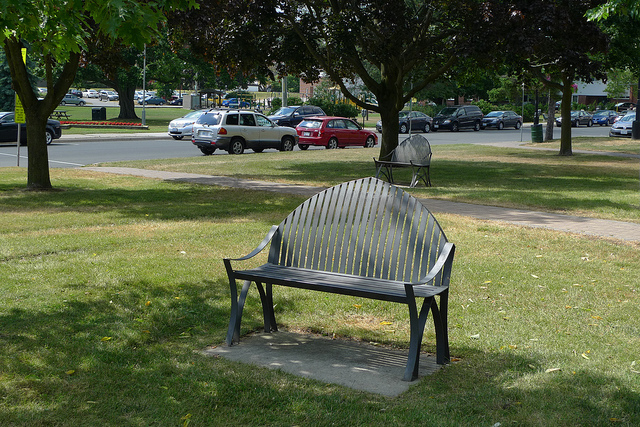

# 通用科研汇报

---
layout: agenda
heading: 汇报提纲
active: 2
agendaStyle: tiles
agenda:
  - 研究问题与背景
  - 方法与系统设计
  - 示例数据与结果
  - 总结与后续工作
---

---
heading: 表格与示例数据
---

- 用表格比较具有相同定义和单位的指标。
- **以下为排版示例数据，不是真实实验结果。**

| 示例方案 | 参数量（M） | 计算量（G） | 示例得分 |
| --- | ---: | ---: | ---: |
| 方案 A | 12.0 | 2.4 | 0.72 |
| 方案 B | 18.0 | 3.2 | 0.78 |
| 方案 C | 24.0 | 4.1 | 0.81 |

---
layout: two-cols
heading: 图文并排与图片说明
---

## 左侧：解释观察对象

- 保留原始图片比例。
- 用图注交代来源和含义。
- 右图仅用于演示图文排版。

图片来自上游模板的 demo.jpg，不代表任何研究结论。

::right::

<figure>
  
  <figcaption>图 1：示例图片，保持原始比例</figcaption>
</figure>

---
heading: 公式与符号说明
---

以下公式仅用于展示公式排版。

$$
S = \sum_{i=1}^{N} w_i s_i, \qquad \sum_{i=1}^{N} w_i = 1
$$

- $s_i$：第 $i$ 项的示例分数。
- $w_i$：对应权重，所有权重之和为 1。

$$
\int_0^1 x^2\,\mathrm{d}x = \frac{1}{3}
$$

---
heading: 信息块与文字强调
---

强调应服务于信息层级，避免整页高亮。

  
常规信息

  
在这里补充定义、背景或必要说明。

  
注意事项

  
在这里说明实际存在的边界、风险或假设。

  
核心要点

  
在这里概括本节由证据支持的结论。

---
heading: 算法伪代码与输入输出
---

  <strong>Algorithm 1：批次均值（排版示例）</strong>
  
<b>Input：</b>非空数值列表 X

  
<b>Output：</b>X 中所有数值的算术平均值

  <ol>
    <li>初始化 sum ← 0</li>
    <li>对列表 X 中的每个 x：sum ← sum + x</li>
    <li>返回 sum / length(X)</li>
  </ol>

示例假设输入列表非空；实际使用时应明确输入边界。

---
layout: end
---

# 致谢
